<p align="center"></p>

# P.E.U.C. — Preparación para el Examen de la Universidad de Cuenca

Las **2737 preguntas del banco oficial 2026** de la UCuenca, con opciones oficiales, respuestas verificadas, justificación de cada respuesta y simulacros con la estructura y la calificación reales del examen. Funciona en Android, iPhone (web instalable) y cualquier navegador, sin conexión y sin cuentas.

[](https://github.com/DiegoFranciscoG/PEUC/actions/workflows/ci.yml)
[](https://diegofranciscog.github.io/PEUC/)


## Demo

- **Web (también en iPhone):** https://diegofranciscog.github.io/PEUC/ — en Safari: *Compartir → Añadir a pantalla de inicio*.
- **Android:** [descargar `PEUC.apk`](https://github.com/DiegoFranciscoG/PEUC/releases/latest/download/PEUC.apk) (activa "instalar apps de fuentes desconocidas").
- **Usuario de prueba:** no hace falta; la app no tiene cuentas.
- Enlaces directos a cualquier pregunta: `https://diegofranciscog.github.io/PEUC/#/pregunta/1234`.

| Inicio | Práctica con justificación | Simulacro oficial |
|:---:|:---:|:---:|
| 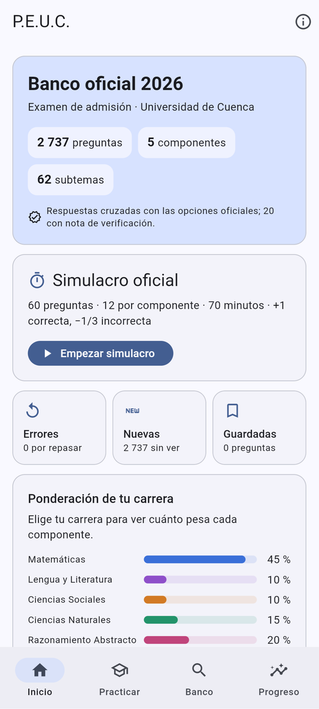 | 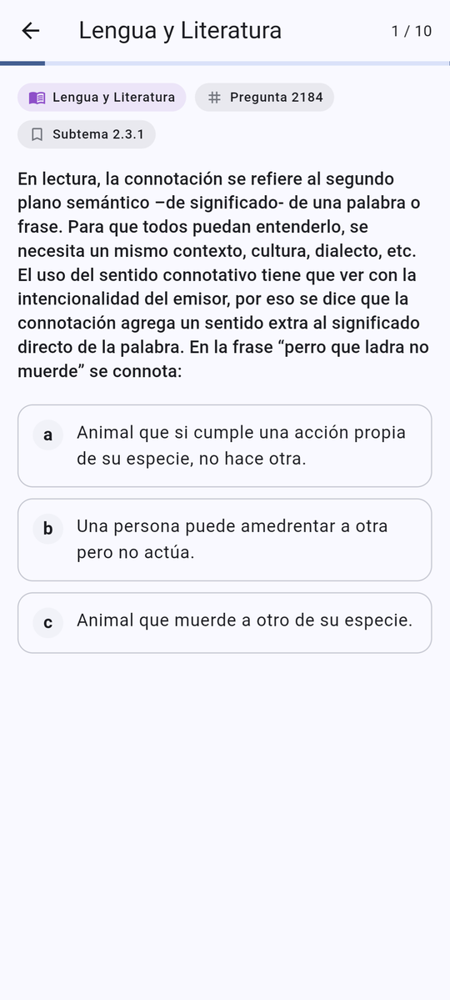 | 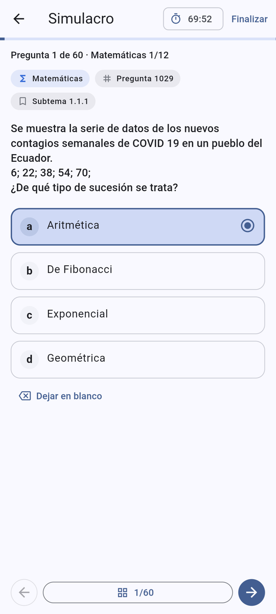 |
| **Resultado ponderado por carrera** | **Banco oficial con buscador** | **Pregunta con imágenes del PDF** |
| 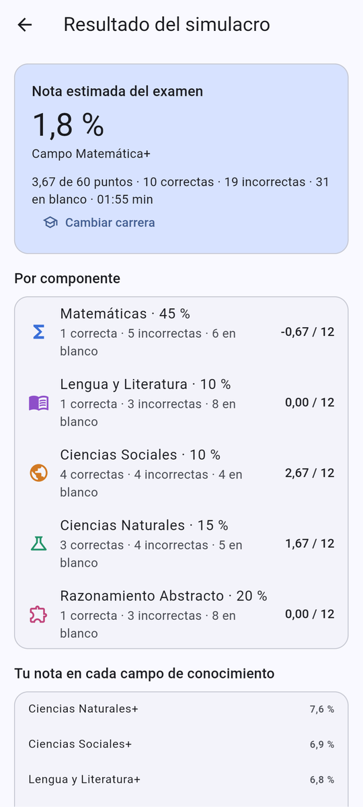 | 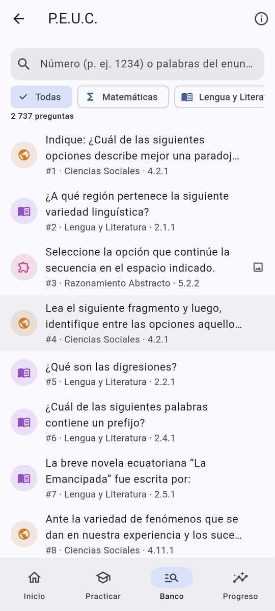 | 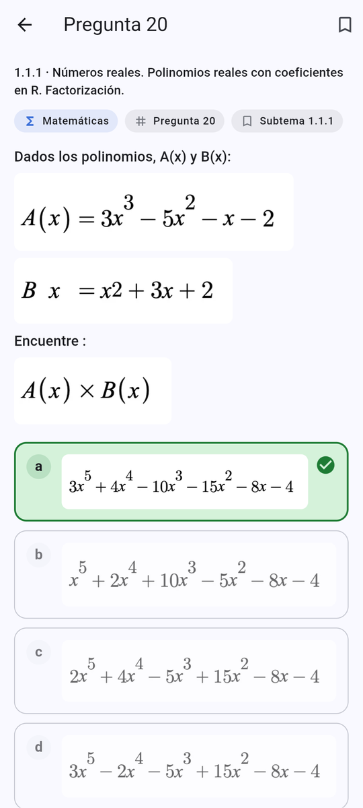 |
| **Progreso** | **Fuentes y verificación** | **Modo oscuro** |
| 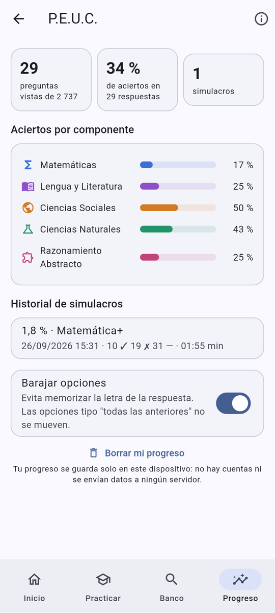 | 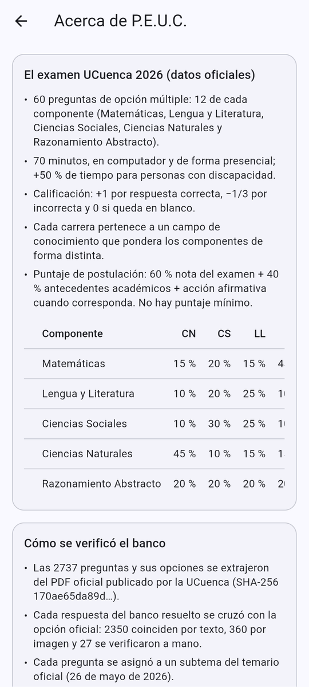 | 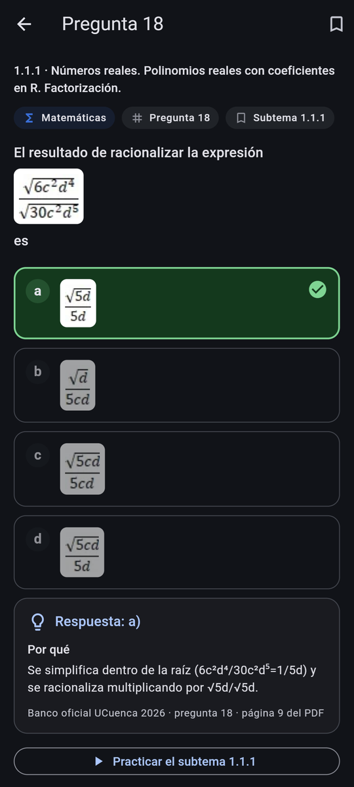 |

> El resultado de la captura es de un simulacro respondido al azar: por la penalización oficial de −1/3, adivinar puede dar nota negativa.

## Problema que resuelve

El 27 de julio de 2026 la UCuenca publicó un PDF de 1148 páginas con las 2737 preguntas de las que sale su examen de admisión (15 664 aspirantes), **sin respuestas, sin áreas y sin temas**. Los aspirantes circulaban versiones "resueltas" sin verificar, y la versión anterior de esta app tenía 1121 preguntas propias que no coincidían con ninguna del banco oficial. P.E.U.C. convierte ese PDF en una herramienta de estudio con respuestas contrastadas contra las opciones oficiales y un simulacro con las reglas reales: 60 preguntas, 70 minutos, +1 / −1/3 y ponderación según la carrera.

## Funcionalidades

- **Banco oficial completo:** 2737 preguntas con sus opciones e imágenes, que se muestran al mismo tamaño relativo que en el PDF (fórmulas, figuras y secuencias).
- **Respuestas verificadas:** la respuesta de cada pregunta se cruzó con la opción oficial (2350 por texto, 360 por imagen y 27 a mano); **3 respuestas corregidas** y 20 preguntas con nota de verificación visible.
- **Práctica por componente y subtema** (62 subtemas del temario oficial) con retroalimentación inmediata y justificación.
- **Simulacro oficial:** 12 preguntas por componente, cronómetro de 70 min, mapa de preguntas, dejar en blanco y calificación +1 / −1/3 / 0.
- **Nota ponderada por carrera:** eliges entre las 56 carreras y ves tu nota en su campo y en los 5 campos de conocimiento.
- **Repaso inteligente:** primero las preguntas que fallaste, luego las que no has visto; preguntas guardadas.
- **Buscador** por número o texto (sin tildes), filtro por componente y por preguntas con observación.
- **Progreso local:** aciertos por componente, subtemas débiles e historial de simulacros.
- **Offline y privada:** sin backend, sin cuentas, sin analítica; si el navegador bloquea el almacenamiento, sigue funcionando y lo avisa.

## Arquitectura

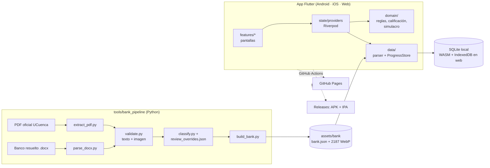

## Stack y por qué

| Capa | Tecnología | Motivo |
|---|---|---|
| App | Flutter 3.44 + Dart 3.12 | Un solo código para Android, iOS y web; renderizado idéntico en las tres. |
| Estado | Riverpod 3 | Proveedores asíncronos y fáciles de sustituir en tests (banco y base falsos). |
| Datos locales | sqflite + sqflite_common_ffi_web | SQLite real en móvil y SQLite WebAssembly sobre IndexedDB en la web; migraciones versionadas. |
| Contenido | JSON + WebP empaquetados | Offline-first: el banco viaja en la app, sin servidor ni costos. |
| Pipeline | Python 3.13, PyMuPDF, python-docx, Pillow | Extraer texto, posiciones e imágenes del PDF sin OCR y verificar imágenes por píxeles. |
| CI/CD | GitHub Actions, gitleaks | Tests, cobertura, escaneo de secretos, publicación web y releases automáticas. |
| Contenedor | Docker multi-stage + nginx sin privilegios | `docker compose up --build` sirve la web con cabeceras de seguridad. |

## Modelo de datos

Contenido (banco oficial, solo lectura) y progreso (SQLite, lectura/escritura) están separados. Detalle, restricciones y reglas en [docs/modelo-datos.md](docs/modelo-datos.md), derivado de las fuentes de [docs/investigacion.md](docs/investigacion.md).

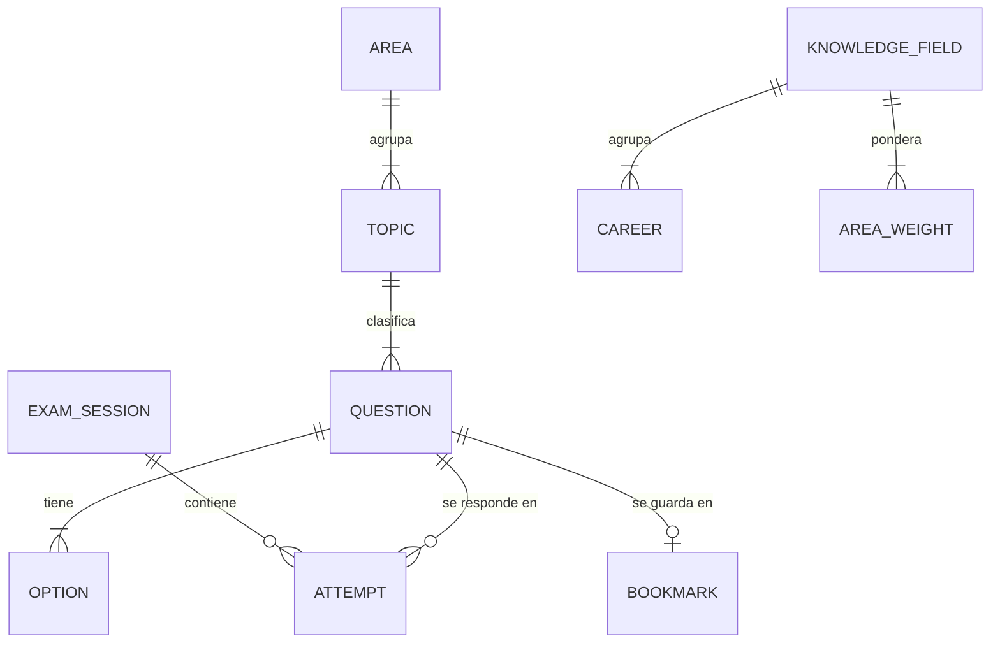

## Ejecutar en local

**Con Docker (versión web):**
```bash
docker compose up --build
```
Abre http://localhost:8080 (si el puerto está ocupado: `PEUC_PORT=8090 docker compose up --build`). La imagen sirve la web con nginx sin root, *healthcheck* en `/healthz`, CSP estricta y sistema de archivos de solo lectura.

**Sin Docker:**
```bash
flutter pub get
flutter run -d chrome        # web
flutter run                  # Android o iOS conectado
flutter build apk --release  # APK en build/app/outputs/flutter-apk/
```

**Regenerar el banco** (requiere el PDF oficial y el banco resuelto, que no se versionan):
```bash
cd tools/bank_pipeline
python -m pip install -r requirements.txt
python build_bank.py --pdf Banco_de_preguntas_UCuenca_2026.pdf --docx Banco_UCuenca_2026_RESUELTO.docx
```
Genera `assets/bank/` y `docs/reporte-validacion.md`.

## Variables de entorno

La app no usa secretos. Solo la **firma de la versión release de Android** lee estas variables (ver [.env.example](.env.example)); en GitHub se configuran como *Secrets*.

| Variable | Descripción | Obligatoria |
|---|---|---|
| `ANDROID_KEYSTORE_PATH` | Ruta del keystore (en CI se crea desde el secreto `ANDROID_KEYSTORE_BASE64`) | No: sin ella se firma con la llave de depuración |
| `ANDROID_KEYSTORE_PASSWORD` | Contraseña del keystore | Sí, si hay keystore |
| `ANDROID_KEY_ALIAS` | Alias de la llave | Sí, si hay keystore |
| `ANDROID_KEY_PASSWORD` | Contraseña de la llave | Sí, si hay keystore |

## API

No aplica: es una app **offline-first sin backend** (sin API REST ni Swagger). El "contrato" de datos es `assets/bank/bank.json`, validado por `test/data/bank_parser_test.dart`.

## Tests y cobertura

```bash
flutter analyze
flutter test --coverage
python tools/coverage_gate.py coverage/lcov.info 70 lib/domain lib/data
cd tools/bank_pipeline && python -m pip install -r requirements-dev.txt && python -m pytest -q
```

- **66 tests de Flutter:** reglas del examen, calificación, reparto del simulacro, barajado, búsqueda, parser e integridad del banco real (2737 preguntas, 62 subtemas, todas las imágenes existen), base SQLite con migraciones y restricciones, contrato común de los dos almacenes de progreso y flujos de widgets (práctica, simulacro completo, almacenamiento bloqueado).
- **Cobertura de la lógica de negocio (`lib/domain` + `lib/data`): 97,6 %**; todo `lib/`: 72,4 %. La CI falla por debajo del 70 %.
- **25 tests del pipeline** (pytest), incluida una prueba de integración con el PDF y el `.docx` reales que se activa con `BANK_PDF` y `BANK_DOCX`.

## Despliegue (gratis)

| Destino | Qué | Cómo | Límite del plan gratuito |
|---|---|---|---|
| GitHub Pages | Web / PWA | `deploy-web.yml` en cada push a `main` | Sitio ≤ 1 GB (la web pesa ≈ 55 MB), 100 GB/mes de tráfico |
| GitHub Releases | `PEUC.apk` y `PEUC-sin-firmar.ipa` | `release.yml` al crear un tag `v*` | Archivos < 2 GB |
| iPhone | PWA desde Safari | sin costo | La App Store exige Apple Developer (99 USD/año) |

## Seguridad aplicada

- Sin backend, sin cuentas y sin datos personales (minimización, LOPDP de Ecuador); el progreso nunca sale del dispositivo.
- La versión release de Android **no pide permiso de Internet**.
- Cero secretos en el repositorio: la firma de Android llega por variables de entorno o GitHub Secrets y la build falla si falta una (sin valores por defecto).
- SQL parametrizado, restricciones `CHECK` y claves foráneas en la base local.
- gitleaks sobre todo el historial en cada push y PR; Dependabot para pub, pip, Docker y Actions; acciones con versión exacta y `permissions` mínimos.
- Web sin CDNs de terceros (CanvasKit, fuentes y SQLite WASM propios) y `Referrer-Policy: no-referrer`; en Docker, CSP estricta sin JavaScript en línea, `X-Frame-Options`, `nosniff`, `Permissions-Policy`, nginx sin root, sistema de archivos de solo lectura y `no-new-privileges`.
- El historial se limpió de binarios pesados (APK de 63 MB y zip de la web) antes de publicar.

## Decisiones técnicas

- **Extraer el PDF por posición y fuente en vez de OCR.** El PDF es regular (número en negrita a la izquierda, opciones "a)" en negrita): leer tamaños, negritas, líneas base e imágenes da 0 errores de numeración y conserva superíndices y subíndices (x², H₃PO₄).
- **Verificar el banco resuelto en lugar de confiar en él.** Cada letra se contrasta con la opción oficial por texto (similitud normalizada) o por imagen (miniaturas recortadas y diferencia media de píxeles; un hash perceptual de 64 bits dio falsos positivos con fórmulas casi iguales). Así aparecieron las respuestas incorrectas y dos ítems oficiales sin opción correcta.
- **Etiquetado manual del temario con clasificador de apoyo.** El TF-IDF acertaba el área pero fallaba el subtema; la etiqueta final es una revisión humana versionada (`review_overrides.json`) que el pipeline aplica.
- **Contenido separado del progreso.** El banco es un asset versionado; la base solo guarda progreso. Actualizar preguntas no exige migraciones.
- **Degradación elegante en la web.** Si IndexedDB falla (modo privado, disco lleno), `ProgressStore` cambia a memoria en 8 s y la app lo avisa en vez de quedarse cargando.
- **Barajar opciones.** En el banco resuelto el 40 % de las respuestas es "a"; se barajan salvo "todas/ninguna de las anteriores" y V/F.
- **Rutas como enlaces web** (`#/pregunta/1234`) para compartir preguntas y probar pantallas directamente.

## Roadmap

- [ ] Resúmenes por subtema con fuentes citables (se retiraron los resúmenes anteriores por no estar verificados).
- [ ] Modo examen con +50 % de tiempo (accesibilidad) y simulacro por componente cronometrado.
- [ ] Exportar e importar el progreso entre dispositivos (archivo local, sin servidor).
- [ ] Firma de release de Android propia para actualizaciones sin reinstalar.

## Fuentes de datos y licencias

- **Preguntas, opciones e imágenes:** *Banco de preguntas · Examen de admisión 2026*, Universidad de Cuenca (publicado el 27-jul-2026). No declara licencia; se redistribuye sin fines de lucro, con atribución y para preparación de aspirantes, como fue publicado. Se retirará si la universidad lo solicita. **Proyecto independiente, no afiliado a la Universidad de Cuenca.**
- **Reglas del examen, ponderaciones y temario:** página del examen, *Guía del Examen de Admisión 2026* y *Temarios UCuenca 2026* (UCuenca).
- **Respuestas y justificaciones:** banco resuelto del autor, verificado contra el PDF oficial ([reporte](docs/reporte-validacion.md)).
- **Fuente Roboto:** Apache License 2.0 ([licencia](assets/fonts/LICENSE-Roboto.txt)).
- Tabla completa fuente → fecha → uso en [docs/investigacion.md](docs/investigacion.md).

## Autor

**Diego Francisco Granda Zhingre** · [GitHub](https://github.com/DiegoFranciscoG) · [LinkedIn](https://www.linkedin.com/in/diego-francisco-g-61b793254/) · [Portafolio](https://diegofranciscog.github.io/)
