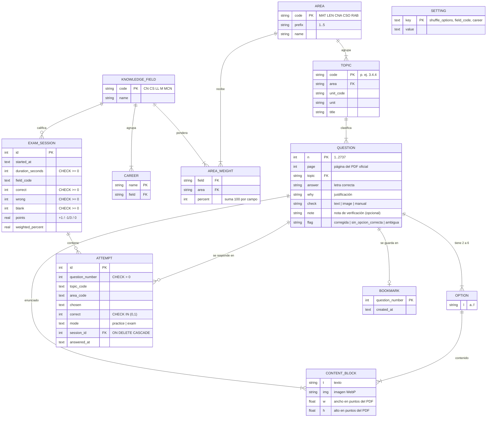

# Modelo de datos

El modelo tiene dos partes con ciclos de vida distintos:

1. **Banco oficial (contenido, solo lectura)** — `assets/bank/bank.json` + `assets/bank/img/*.webp`, generado por `tools/bank_pipeline` a partir del PDF oficial y del banco resuelto. Viaja dentro de la app (offline-first) y se versiona con `version` (`2026.1.0`).
2. **Progreso del estudiante (lectura/escritura)** — SQLite local (`peuc.db`; en la web, SQLite WebAssembly sobre IndexedDB) con migraciones versionadas en `lib/data/app_database.dart`. Si el navegador bloquea el almacenamiento, se usa un almacén en memoria con el mismo contrato.

Separar contenido y progreso evita el problema de la versión anterior (22 versiones de esquema solo para recargar preguntas): actualizar el banco no requiere migrar la base.

## Diagrama entidad-relación

## Tablas de la base local (migración v1)

| Tabla | Campo | Tipo | Restricción | Regla / fuente (# en investigacion.md) |
|---|---|---|---|---|
| exam_sessions | id | INTEGER | PK autoincremental | — |
| exam_sessions | started_at | TEXT (ISO-8601) | NOT NULL | — |
| exam_sessions | duration_seconds | INTEGER | NOT NULL, ≥ 0, tope 4 200 s | 70 minutos (#2) |
| exam_sessions | field_code | TEXT | NOT NULL | campo prioritario de la carrera (#1) |
| exam_sessions | correct / wrong / blank | INTEGER | NOT NULL, ≥ 0; suman 60 | 60 preguntas, 12 por componente (#1, #2) |
| exam_sessions | points | REAL | NOT NULL | +1 / −1/3 / 0 (#2) |
| exam_sessions | weighted_percent | REAL | NOT NULL | ponderación por campo (#1); escala SUPUESTO |
| attempts | question_number | INTEGER | NOT NULL, > 0 | número del banco oficial (#4) |
| attempts | topic_code, area_code | TEXT | NOT NULL | temario oficial (#3) |
| attempts | chosen | TEXT | NOT NULL | letra oficial elegida (las respuestas en blanco no se guardan) |
| attempts | correct | INTEGER | NOT NULL, CHECK IN (0,1) | respuesta del banco verificada (#4, #6) |
| attempts | mode | TEXT | CHECK IN ('practice','exam') | — |
| attempts | session_id | INTEGER | FK → exam_sessions ON DELETE CASCADE | — |
| bookmarks | question_number | INTEGER | PK, > 0 | — |
| settings | key / value | TEXT | PK / NOT NULL | preferencias locales |

Índices: `idx_attempts_question(question_number)` y `idx_attempts_topic(topic_code)` para las estadísticas por pregunta y subtema.

## Catálogos oficiales

- **Componentes (5)** y **subtemas (62)**: `tools/bank_pipeline/data/syllabus_2026.json` (#3).
- **Campos de conocimiento, ponderaciones y 56 carreras**: `lib/domain/admission_rules.dart` (#1). Cada campo suma 100 %; Razonamiento Abstracto pesa 20 % en todos.

| Componente | CN+ | CS+ | LL+ | M+ | MCN+ |
|---|---:|---:|---:|---:|---:|
| Matemáticas | 15 % | 20 % | 15 % | 45 % | 40 % |
| Lengua y Literatura | 10 % | 20 % | 25 % | 10 % | 10 % |
| Ciencias Sociales | 10 % | 30 % | 25 % | 10 % | 10 % |
| Ciencias Naturales | 45 % | 10 % | 15 % | 15 % | 20 % |
| Razonamiento Abstracto | 20 % | 20 % | 20 % | 20 % | 20 % |

## Reglas de negocio

| Regla | Dónde | Fuente |
|---|---|---|
| Simulacro de 60 preguntas: 12 por componente en el orden de la guía | `ExamBuilder.simulation` | #1, #2 |
| Reparto por subtema proporcional al banco (resto mayor) | `ExamBuilder.allocateProportionally` | SUPUESTO |
| Nota por componente = correctas − incorrectas/3 | `ComponentResult.points` | #2 |
| Nota ponderada = Σ peso del campo × % del componente | `ExamScore.weightedPercent` | #1 |
| Práctica prioriza falladas, luego no vistas | `ExamBuilder.practiceSet` | decisión pedagógica |
| Las opciones se barajan salvo "todas/ninguna de las anteriores" o V/F | `option_order.dart` | decisión pedagógica (40 % de las respuestas son "a") |
| Respuesta verificada contra la opción oficial por texto o imagen | `tools/bank_pipeline/validate.py` | #4, #6 |
